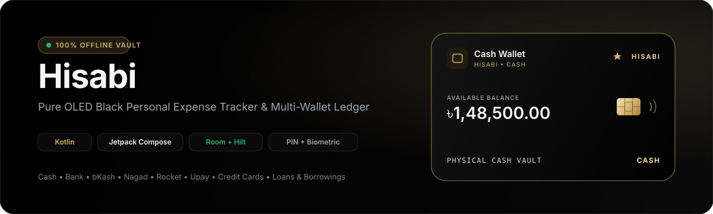
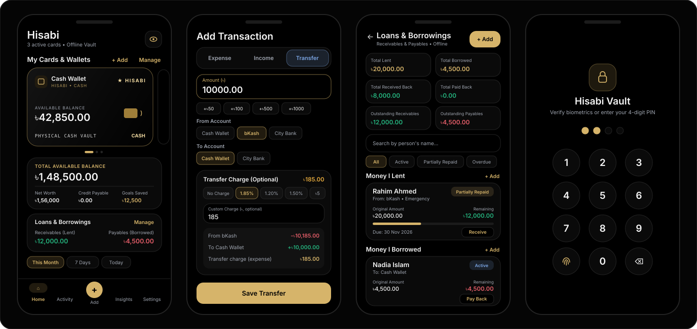
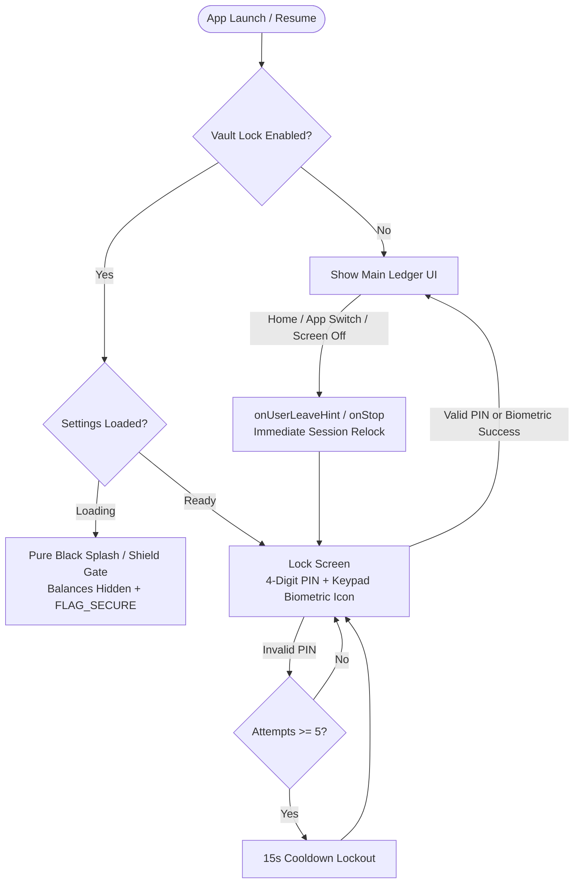
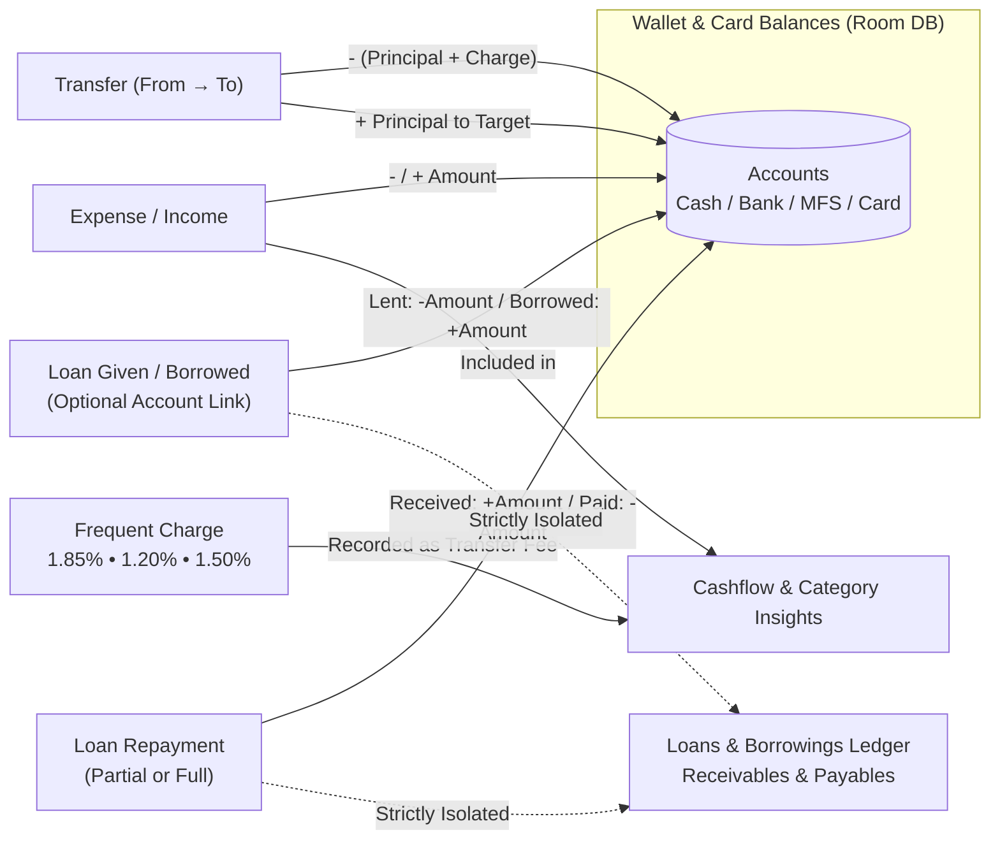
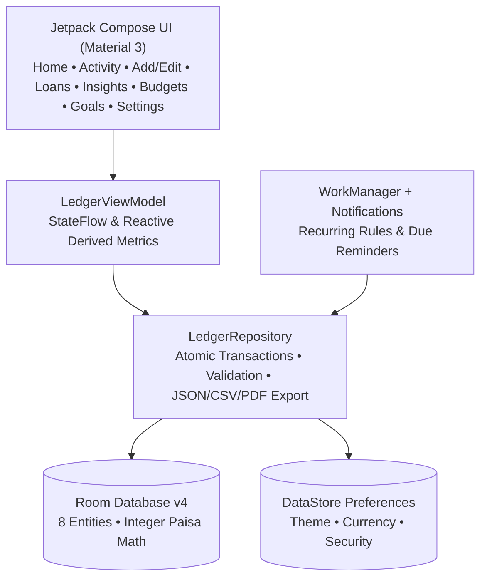

<div align="center">
  
  <h1>Hisabi</h1>
  <p>
    <strong>Pure OLED Black Personal Expense Tracker, Multi-Wallet Ledger &amp; Loans Vault for Android</strong>
  </p>
  <p>
    Built with Kotlin, Jetpack Compose, Room, and Hilt — 100% offline with zero telemetry, zero cloud lock-in, and strict PIN/biometric vault protection.
  </p>

  <p>
    <a href="https://github.com/0xrobiul/Hisabi">
      
    </a>
    
    
    
    
  </p>

  <p>
    <a href="#-interface-preview">Interface Preview</a> •
    <a href="#-core-features">Core Features</a> •
    <a href="#-architecture--flowcharts">Flowcharts</a> •
    <a href="#-oled-design-tokens">Design Tokens</a> •
    <a href="#-tech-stack">Tech Stack</a> •
    <a href="#-getting-started">Getting Started</a>
  </p>
</div>

<p align="center">
  
</p>

---

## 📱 Interface Preview

<p align="center">
  
</p>

<p align="center">
  <sub>
    <strong>1. Home:</strong> Swipeable <code>BankCardVisual</code>, Portfolio &amp; Loans Summary &nbsp;|&nbsp;
    <strong>2. Add Transfer:</strong> Frequent Charges (<code>1.85%</code>, <code>1.20%</code>, <code>1.50%</code>) &amp; Live Breakdown &nbsp;|&nbsp;
    <strong>3. Loans:</strong> 6 Summary Tiles &amp; Account Sync &nbsp;|&nbsp;
    <strong>4. Vault Lock:</strong> Pure Black Keypad + Biometric
  </sub>
</p>

---

## ✨ Core Features

<table>
  <tr>
    <td width="56" align="center" valign="top">
      
    </td>
    <td valign="top">
      <strong>Multi-Wallet Virtual Cards</strong><br/>
      Manage <strong>Cash</strong> (default), <strong>Bank</strong>, <strong>Credit Cards</strong>, and Bangladeshi MFS wallets (<strong>bKash</strong>, <strong>Nagad</strong>, <strong>Rocket</strong>, <strong>Upay</strong>, or custom accounts) as swipeable matte-black virtual cards with customizable gradients, card pinning, credit limit tracking, and instant balance updates.
    </td>
  </tr>
  <tr>
    <td width="56" align="center" valign="top">
      
    </td>
    <td valign="top">
      <strong>Expenses, Income &amp; Account Transfers with Charge Presets</strong><br/>
      Log expenses, income, fees, and account-to-account transfers with tags, notes, and local receipt attachments. Transfers include a dedicated <strong>Transfer Charge</strong> panel with one-tap frequent fee presets (<code>1.85%</code>, <code>1.20%</code>, <code>1.50%</code>, plus flat fees), a live source/destination breakdown, and separate fee expense accounting.
    </td>
  </tr>
  <tr>
    <td width="56" align="center" valign="top">
      
    </td>
    <td valign="top">
      <strong>Loans &amp; Borrowings with Source/Destination Account Sync</strong><br/>
      Track money lent (<em>Receivables</em>) and borrowed (<em>Payables</em>) with partial/full repayments, payment methods, automatic <code>Active / Partial / Repaid / Overdue</code> statuses, due-date reminders, and optional source/destination account linking (automatically updating and reverting card balances on create, edit, or delete without distorting expense/income reports).
    </td>
  </tr>
  <tr>
    <td width="56" align="center" valign="top">
      
    </td>
    <td valign="top">
      <strong>Insights, Budgets, Savings Goals &amp; Recurring Rules</strong><br/>
      Explore daily, weekly, monthly, and yearly Vico cashflow charts and category donuts; configure threshold-alerted spending budgets; fund or withdraw account-linked savings goals; and automate recurring transactions via <code>WorkManager</code>.
    </td>
  </tr>
  <tr>
    <td width="56" align="center" valign="top">
      
    </td>
    <td valign="top">
      <strong>Strict Cold-Start &amp; Background Vault Lock</strong><br/>
      Protected with a 4-digit SHA-256 hashed PIN, brute-force keypad cooldown, keypad-embedded biometric trigger (no bypass/skip actions), <code>FLAG_SECURE</code> recent-tasks snapshot masking, a cold-start loading gate that prevents balance leaks before unlock, and instant relock on app exit (<code>onUserLeaveHint</code> / <code>onStop</code>).
    </td>
  </tr>
  <tr>
    <td width="56" align="center" valign="top">
      
    </td>
    <td valign="top">
      <strong>100% Offline Storage &amp; Portable Exports</strong><br/>
      Uses integer minor-unit (paisa) precision inside Room SQLite with zero network permissions required. Export formatted <strong>PDF statements</strong>, <strong>CSV spreadsheets</strong>, or complete <strong>JSON v4</strong> offline backups (including accounts, transactions, budgets, goals, recurring rules, and loan/repayment links).
    </td>
  </tr>
</table>

---

## 🔀 Architecture & Flowcharts

### 1. App Launch & Strict Vault Security Flow



### 2. Accounting, Transfer Charge & Loan Isolation Flow



### 3. Clean MVVM & Offline Data Architecture



---

## 🎨 OLED Design Tokens

Hisabi defaults to a **True Pure Black (`#000000`)** OLED palette paired with **Champagne Gold** luxury accents (with optional Light and System theme support):

| Token | Hex | Preview | Usage |
| :--- | :--- | :---: | :--- |
| **Pure OLED Black** | `#000000` |  | Primary app &amp; lock screen background |
| **Card Surface** | `#0A0A0A` |  | Summary cards, tiles &amp; keypad buttons |
| **Elevated Surface** | `#121212` |  | Breakdown containers, sheets &amp; chips |
| **Hairline Border** | `#242424` |  | Card outlines &amp; subtle dividers |
| **Champagne Gold** | `#D6B46A` |  | Primary CTA, active borders &amp; accents |
| **Emerald Positive** | `#24B47E` |  | Income, inflows &amp; receivables |
| **Crimson Negative** | `#E45D68` |  | Expenses, outflows, overdue &amp; payables |
| **Transfer Blue** | `#7CA7E6` |  | Transfer switcher &amp; active loan badges |
| **Primary Text** | `#F5F5F5` |  | Headings, balances &amp; primary labels |
| **Secondary Text** | `#A1A7B2` |  | Subtitles, metadata &amp; timestamps |

---

## 🛠 Tech Stack

| Layer | Technology |
| :--- | :--- |
| **Language & UI** | Kotlin `2.4.21`, Jetpack Compose (BOM `2024.09.00`), Material Design 3 |
| **Architecture** | MVVM + Single-Source-of-Truth Repository (`LedgerViewModel`, `LedgerRepository`) |
| **Dependency Injection** | Hilt `2.59.2` + Hilt Work (`1.2.0`) |
| **Local Database** | Room `2.7.0` (SQLite schema v4, KSP) with integer minor-unit (`Long` paisa) math |
| **Preferences** | Jetpack DataStore Preferences `1.1.7` |
| **Navigation** | Navigation Compose `2.8.9` |
| **Charts & Media** | Vico Compose M3 `2.1.2`, Coil `2.7.0` |
| **Background & Security** | WorkManager `2.10.0`, AndroidX Biometric `1.1.0`, SHA-256 PIN Hashing |

---

<details>
<summary><strong>📁 Project Structure</strong> (click to expand)</summary>

```text
Hisabi/
├── docs/assets/                  # GitHub README banner, UI showcase & SVG icons
├── app/src/main/java/com/example/
│   ├── MainActivity.kt           # Edge-to-edge host, Navigation Compose, strict vault relock & FLAG_SECURE
│   ├── CardVaultApplication.kt   # Hilt + WorkManager application setup
│   ├── data/
│   │   ├── local/                # Room database (v4), DAOs, entities, DataStore preferences
│   │   └── repository/           # Atomic ledger, transfers, loans, budgets, goals & backup repository
│   ├── di/                       # Hilt dependency modules
│   ├── ui/
│   │   ├── components/           # Virtual card visuals, transaction/loan sheets, Vico charts
│   │   ├── screens/              # Home, Activity, Add/Edit, Insights, Accounts, Loans, Budgets, Goals, Lock, Settings
│   │   ├── theme/                # Pure OLED black & light Material 3 ColorScheme, Typography & Shapes
│   │   └── viewmodel/            # LedgerViewModel & derived UI state
│   ├── util/                     # InputValidator, Formatters, PinSecurity, LoanCalculations, PdfExporter, Notifications
│   └── worker/                   # WorkManager recurring transaction worker
└── app/src/test/java/com/example/
    └── ExampleUnitTest.kt        # Unit tests for accounting math, loans, transfer charges & validators
```

</details>

<details>
<summary><strong>🗄️ Room Database Schema (Version 4)</strong> (click to expand)</summary>

| Entity | Purpose |
| :--- | :--- |
| `AccountEntity` | Cash, Bank, Credit Card, and MFS wallets with gradient themes, pin state, and minor-unit balances |
| `CategoryEntity` | Income & expense categories with icons and hex colors |
| `TransactionEntity` | Expenses, income, transfers (`toAccountId`), transfer charges, tags, notes, and receipt URI |
| `BudgetEntity` | Category spending limits across weekly, monthly, or custom windows |
| `SavingsGoalEntity` | Target amounts, saved progress, and linked wallet accounts |
| `RecurringRuleEntity` | Automated daily/weekly/monthly/yearly schedules executed by WorkManager |
| `LoanRecordEntity` | Money lent/borrowed records with optional `accountId`, due date, notes, and reminder flags |
| `LoanRepaymentEntity` | Partial/full repayment history linked to `loanId` (CASCADE) and optional `accountId` |

</details>

---

## 🚀 Getting Started

### Prerequisites

- **Android Studio** (Ladybug or newer) / Android Gradle Plugin `9.1.1`
- **JDK 17+**
- **Android SDK**: `minSdk 26` (Android 8.0) • `compileSdk 36` • `targetSdk 36`

### Clone & Build

```bash
git clone https://github.com/0xrobiul/Hisabi.git
cd Hisabi
```

Run the local unit test suite (covers input validation, transfer percentage math, and loan/account sync logic):

```bash
./gradlew :app:testDebugUnitTest --tests "me.robiul.hisabi.ExampleUnitTest"
```

Build a debug APK:

```bash
./gradlew :app:assembleDebug
```

> **Note:** Hisabi declares only `POST_NOTIFICATIONS` (optional, for budget alerts and loan due-date reminders) and requests **no internet permission**, guaranteeing your financial records never leave your device.

---

## 👤 Developer

<div align="center">
  <strong>Robiul Awal Fagun</strong><br/>
  <a href="https://0xrobiul.me">0xrobiul.me</a> &nbsp;•&nbsp;
  <a href="https://github.com/0xrobiul/Hisabi">github.com/0xrobiul/Hisabi</a>
</div>
